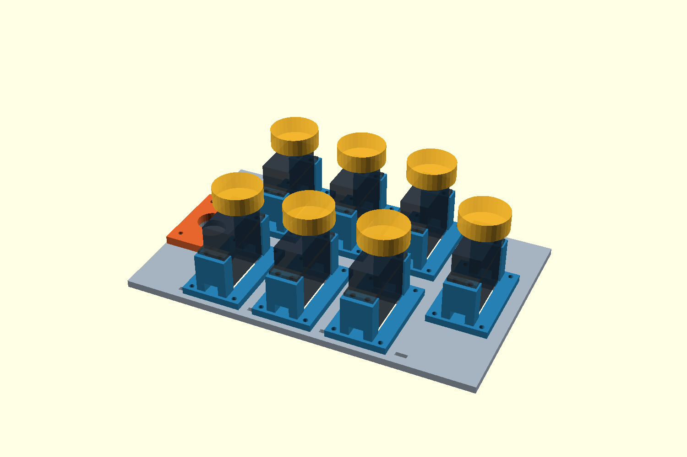

# Robotic Hand

A tendon-driven, seven-channel robotic hand with interchangeable PC inputs,
an adjustable forearm layout, and a staged path toward contact-aware grasping.

Start with [build status](docs/BUILD_STATUS.md), the [engineering plan](docs/ENGINEERING_PLAN.md),
and the [measurement worksheet](docs/MEASUREMENTS.md).
The converted [PRD](docs/PRD.md) preserves the supplied requirements; engineering
corrections and unresolved assumptions live in the separate plan.

The first complete-arm target is [picking up and moving a pen with about 30 cm
of reach](docs/ARM_TARGET.md). Arm actuators remain to be sized from the actual
hand, link and payload masses.

Explore the [project architecture and roadmap](docs/PROJECT_MAP.md) or the
[Graphify code map](docs/graph/README.md) with interactive and static views.



This adjustable bench layout is a packaging prototype. Tendon routing, compact
forearm geometry, hand attachment and physical fit still need development.

## What is here

| Path | Purpose |
| --- | --- |
| `docs/PRD.md` | Original pasted requirements converted to Markdown |
| `docs/Robotic_Hand_Build_Plan.pdf` | Supplied companion build plan; earlier six-joint snippets are historical |
| `firmware/hand_executor/` | ESP32-S3 executor, seven validated targets, watchdog and telemetry |
| `pc/hand.py` | Serial boundary, validation, CSV logging and hardware-free mode |
| `pc/sliders.py` | Manual control, RAM calibration, explicit enable and persistent disable |
| `pc/camera.py` | MediaPipe Tasks webcam input; tracking loss opens fingers |
| `cad/finger_test_rig.scad` | Adjustable single-servo tendon test fixture |
| `cad/README.md` | Forearm concept, export inventory and dimensional assumptions |
| `config/measurements.json` | Unmeasured values explicitly recorded as null |
| `tools/design_calcs.py` | Pulley, servo mass/current and gravity-moment estimates |
| `tests/` | Hardware-free regression checks |

## Start without hardware

From this folder:

```powershell
python -m unittest discover -s tests -v
python tools/design_calcs.py
python pc/sliders.py --dry --log runs/sliders-dry.csv
```

The sliders start disabled. Enable sends the current slider positions at 20 Hz.
Relax stops sending targets and disables PWM. Motion remains disabled until
Enable is clicked again. Dry mode never opens a serial device.

## One-servo commissioning

1. Complete the measurements worksheet and review the firmware notes.
2. Install Arduino ESP32 support, ArduinoJson v7 and Adafruit PWM Servo Driver.
   Compile for `esp32:esp32:esp32s3`. Select the port appropriate to the board's
   actual USB connector and USB-CDC build configuration.
3. Connect logic only: ESP32 GPIO 8 to SDA, GPIO 9 to SCL, 3V3 to PCA9685 VCC,
   and common ground. Servo V+ uses a separate, current-limited supply.
4. Connect **one unloaded servo with the tendon disconnected**. Establish a
   conservative pulse range and direction before enabling it. Software cannot
   know the horn's real position after power-up or after it was moved while limp.
5. Run `python pc/sliders.py --port COM5 --log runs/bench.csv`, substituting
   the actual COM port. Calibration endpoints are provisional, not measured.
6. Cal changes endpoint angles in RAM only and disables motion. Reapply measured
   calibration after resetting the board; do not mistake telemetry for an encoder.
7. Mount the measured test fixture, confirm return travel and tendon routing,
   then qualify one finger before assembling the full hand.

See [firmware notes](docs/firmware-notes.md) for exact firmware configuration and checks.
No firmware is automatically flashed and no printer job is automatically started.

## Webcam input

```powershell
python -m pip install -r pc/requirements-camera.txt
python pc/camera.py --model models/hand_landmarker.task --dry
python pc/camera.py --model models/hand_landmarker.task --port COM5 --log runs/camera.csv
```

Use the Hand Landmarker model linked from [Google's official guide](https://ai.google.dev/edge/mediapipe/solutions/vision/hand_landmarker).
The camera app needs that local model file. Thumb opposition is a provisional
distance heuristic and must be tuned to the mechanism and user. Live webcam
latency and physical hand tracking accuracy still need measurement.

## Channels and data

PCA9685 channels 0 through 6 are thumb flex, thumb opposition, index, middle,
ring, pinky and wrist. Every command contains exactly seven normalized values.
The default recovery pose opens the fingers and centers the wrist.

CSV records timestamps, source, seven command targets, latest full telemetry and
optional metadata. They are command logs, not yet complete imitation-learning
episodes: synchronized images, measured robot positions, contact data and task
outcomes remain to be implemented.

## Printing

Treat all dimensions as provisional until measured. The supplied 3MFs in `cad/`
belong to the original rig; they do not automatically update when SCAD changes.
Their embedded filament preset is **PLA**, despite the supplied document's PETG
claim. Select and verify the actual PETG profile before slicing. Inspect the
embedded settings with `python tools/audit_3mf.py`.
Use fresh exports and the CAD README. Render/mesh checks establish geometric
properties only; fit, load capacity and printability require a real test print.
