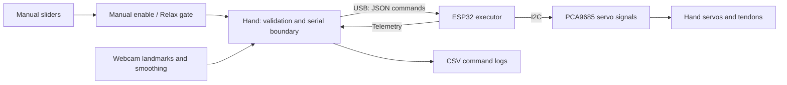

# Robotic Hand + Arm project map

The first complete-arm goal is to **pick up and move a pen with about 30 cm
of reach**. See [the agreed target](ARM_TARGET.md) for the working reach
definition and the measurements still needed before choosing arm motors.

This page explains the project at a system level. The Graphify exports map
relationships extracted from the code; they do not prove that the robot has
been assembled or tested on hardware.

For symbol-level navigation, open the [Graphify code map](graph/README.md),
[graph report](graph/GRAPH_REPORT.md) or [static graph](graph/graph.svg).

## Current control path

The PC converts an input into seven normalized hand targets. The ESP32 checks
those commands and drives the PCA9685. The physical servo path still needs
bench commissioning and calibration.

| Component | Where to look | What it does |
| --- | --- | --- |
| Manual interface | [sliders.py](../pc/sliders.py), [control.py](../pc/control.py) | Starts disabled; sends targets at 20 Hz when enabled; Relax remains disabled until explicitly enabled again. |
| Camera input | [camera.py](../pc/camera.py) | MediaPipe Tasks landmarks become smoothed targets; lost or invalid tracking requests open fingers and a centered wrist. Needs optional packages and a local model. |
| Hardware boundary | [hand.py](../pc/hand.py) | Validates seven finite values, serializes commands, receives telemetry and optionally logs CSV. Dry mode avoids the serial device. |
| Firmware protocol | [hand_executor.ino](../firmware/hand_executor/hand_executor.ino) | Parses bounded JSON lines, controls PWM output and sends telemetry. |
| Motion state | [executor_state.h](../firmware/hand_executor/executor_state.h) | Applies calibrated endpoints, target rate limits and the 500 ms command watchdog. |

The seven hand channels are thumb flex, thumb opposition, index, middle, ring,
pinky and wrist. Arm joints are not implemented in this executor.

**Telemetry is a command estimate, not measured finger position.** The current
MG996R setup has no external joint encoders. A rate limit on target values does
not establish measured physical speed, and software Relax does not cut power.

## Mechanical work and build evidence

| Area | Existing artifacts | Limits |
| --- | --- | --- |
| One-servo fixture | [finger_test_rig.scad](../cad/finger_test_rig.scad) and supplied print files | Servo, horn, insert and tendon dimensions still need measurement and fit tests. |
| Seven-servo carrier | [forearm_concept.scad](../cad/forearm_concept.scad), [assembly preview](../cad/generated/forearm-concept.png) and separate STL exports | A wide bench integration concept; tendon routing, compact forearm packaging, hand attachment and final elbow bearing interface are unfinished. |
| Design estimates | [design_calcs.py](../tools/design_calcs.py), [measurements.json](../config/measurements.json) | Planning inputs are provisional; unmeasured values remain explicit. |
| Geometry checks | [check_stl.py](../tools/check_stl.py), [CAD notes](../cad/README.md) | Topology and bounding dimensions do not establish print fit, strength or load capacity. |
| Software checks | [tests](../tests), [firmware notes](firmware-notes.md) | Tests cover command validation, control behavior, camera geometry and the C++ motion state; they do not exercise a complete physical robot. |

The current status and earlier verification results are recorded in
[BUILD_STATUS.md](BUILD_STATUS.md). The original rig 3MF files embed a PLA
preset despite the source document's PETG claim; select the actual material
and re-slice before printing.

## Planned expansion

The dashed connections below are a roadmap, not implemented interfaces.

```mermaid
flowchart LR
    Band["Forearm FSR band"] -.-> Inputs["PC input pipeline"]
    Inputs -.-> Contact["Contact-aware hand control"]
    Contact -.-> Arm["Arm drives and joint feedback"]
    Arm -.-> IK["Robot model and inverse kinematics"]
    IK -.-> Vision["Camera calibration and object location"]
    Vision -.-> Grasp["Scripted pen pickup"]
    Grasp -.-> Learning["Demonstrations and learned policies"]
```

FSR acquisition, fingertip contact feedback, arm drives, position feedback,
inverse kinematics and autonomous grasping remain future work. Existing CSVs
contain commands and asynchronous telemetry, not complete synchronized learning
episodes. Shoulder and elbow sizing must include the hand and downstream links,
even when the object is only a pen.

For the ordered build gates and power/mechanical constraints, continue with
[the engineering plan](ENGINEERING_PLAN.md). The supplied [PRD](PRD.md) remains
the source requirements document; proposed milestones are not completed tests.
