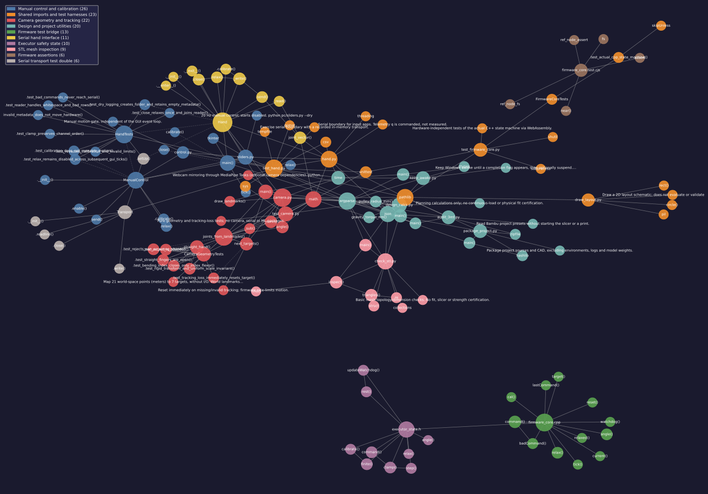

# Graphify code map

For Claude Code and Codex, use the shared [AGENTS.md](../../AGENTS.md) workflow;
[CLAUDE.md](../../CLAUDE.md) imports those same instructions. The working index
is the current local `graphify-out/graph.json`, with query defaults and C++/Arduino
classification in [.graphifyrc](../../.graphifyrc). Build a missing local graph
with `graphify extract . --code-only`. The [agent navigation index](../AGENT_INDEX.md)
points directly to relevant hardware, CAD and requirements sections.

The files below are a human-facing snapshot, not the index agents should query.

Start with the [plain-language project map](../PROJECT_MAP.md). It shows the
current control path, physical components, CAD work and future arm stages.



## Explore the code graph

- [Interactive graph](graph.html): download the file and open it in a browser.
  GitHub displays HTML as source instead of running the page. The viewer uses
  a JavaScript library from a CDN, so an internet connection may be needed.
- [Graph report](GRAPH_REPORT.md): communities, hubs, inferred connections and
  known extraction limitations.
- [Graph data](graph.json): portable node/relationship data for Graphify queries.
- [SVG image](graph.svg): static view that GitHub can render directly.
- [Community names](community-labels.json): human-reviewed group labels for this snapshot.

This code-only snapshot contains **146 nodes, 243 edges and 10 communities**.
It predates the project's Arduino/C++ language overrides; the live graph rebuilt
with the current configuration also includes the firmware sketch. Do not use
the snapshot's counts or coverage limitations as a substitute for inspecting
the current index.
It excludes documents, photographs, private attachments, environments and local
caches. `.graphifyignore` excludes these generated snapshots from re-indexing.
Hardware and future features appear in the separately authored project
map. The automatic graph has documented C++ parsing/name-resolution limitations;
inferred links and self-edges require source inspection.

## Refresh locally

From the repository root, with Graphify installed:

```powershell
graphify extract . --code-only
graphify cluster-only . --no-label
graphify export html
graphify export svg
graphify query "serial target validation" --seed pc_hand_hand_send --context call --budget 800
```

SVG export also requires Matplotlib in the Graphify Python environment. Review
the new communities, graph health and report before replacing the published
snapshot. Revalidate community IDs before reusing the saved community names.
Copy only the reviewed HTML, SVG, graph JSON, labels and report from the ignored
`graphify-out/` directory into this folder. Preserve the coverage notes in the
published report. Do not copy caches, machine-path sidecars or query histories.

After code edits, run `graphify update .`; refresh these published artifacts when
the code map changes. Documentation-only commits can differ from the source
commit recorded by the graph without changing its code relationships.
